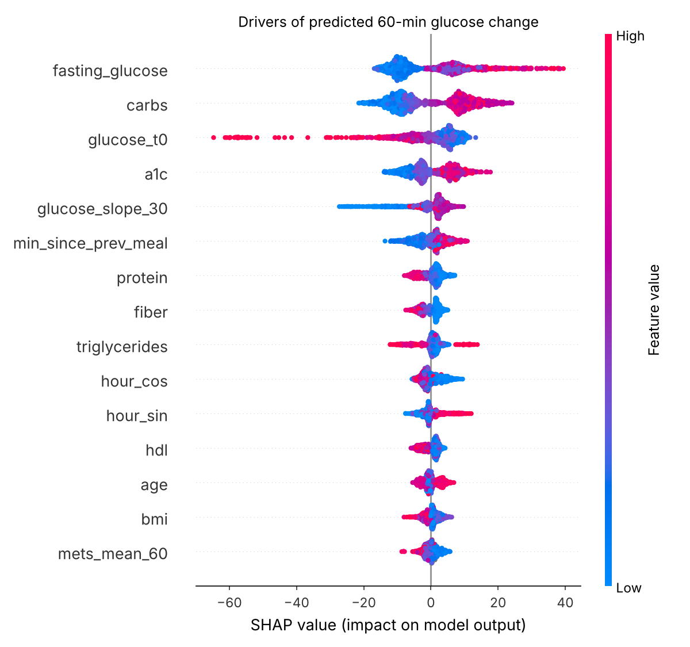

# Glycemic Response Predictor

**Can we predict how an individual's blood glucose will respond to a meal, and does learning from that person's own past meals make the prediction better?**

## Summary

Two people can eat the same meal and have very different glucose responses, which is why generic diet advice often fails. Using the public **CGMacros** dataset (45 adults: 15 healthy, 16 prediabetes, 14 type 2 diabetes; about 10 days of continuous glucose monitoring each; 1,403 meals), I predicted each person's glucose change after a meal: at 30, 60, and 120 minutes, as 2-hour iAUC, as the full 2-hour curve, and as whether the meal causes a high spike.

**Main findings**

1. **Personalisation matters more than model choice.** Learning from a person's own earlier meals cut 60-minute error by **38% compared with a carbs-only rule** (17.8 vs 28.6 mg/dL; 95% CI 32–44%). This gain is much larger than any difference between model types.
2. **Personalisation helps most where it's needed most.** For participants with type 2 diabetes, 60-minute error fell from 35.9 mg/dL (non-personalised model) to **21.7 mg/dL**. A gap with healthy participants remains.
3. **The tree model and the deep model are complementary.** Personalised LightGBM was slightly more accurate at 60 minutes (6.7% lower error; 95% CI 1–12%). The temporal CNN was better at 30 minutes and is the only model that predicts the full curve. **Averaging the two gave the best spike detection: AUROC 0.89** (95% CI 0.86–0.92), compared with 0.60 for carbs alone.
4. **The results are robust:** the improvement holds at 23–25% across sensor choice (Libre vs Dexcom) and data-cleaning rules.

**Full report:** [`docs/report.pdf`](docs/report.pdf)

## Models compared

| ID | Model | Personalised? |
|---|---|---|
| B0 | Group mean (average response of healthy / prediabetes / T2D) | No |
| B1 | Linear regression on carbohydrates only | No |
| M1 | LightGBM: meal, timing, activity, baseline labs | No |
| M2 | M1 + **personal history features** (person's earlier meal responses) | Partly |
| M2b | M2, also trained on the person's first half of meals | **Yes** |
| M3 | **Temporal CNN**: pre-meal glucose trace + all features → full 2-h curve | Partly |
| M4 | M3 **fine-tuned** on the person's first half of meals | **Yes** |

**History features** use only meals the person ate *before* the current one: average past rise, average past iAUC and peak, personal rise per 10 g carbohydrate, and last meal's rise. They're available in practice, since past responses have already been observed.

## Results

### 1. New people (cross-validation grouped by participant, all 1,403 meals)

| Model | 30 min | 60 min | 120 min | iAUC (mg/dL·min) |
|---|---|---|---|---|
| B0 group mean | 18.7 | 28.0 | 27.2 | 2036 |
| B1 carbs only | 18.6 | 28.8 | 28.0 | 2141 |
| M1 LightGBM | 16.0 | 24.8 | 24.3 | 1697 |
| **M2 LightGBM + history** | 14.1 | **22.0** | **23.7** | **1600** |
| M3 Temporal CNN | **13.1** | 24.1 | 25.4 | 1653 |

MAE in mg/dL unless stated. Changes in 60-minute error, with participant-bootstrap 95% CIs:

- M1 vs carbs only: **−14%** (−4 to −22%)
- M2 vs carbs only: **−24%** (−18 to −30%)
- Adding history (M2 vs M1): **−11%** (−5 to −18%)
- CNN vs M2: +10% error (CI −1 to +27%, not a clear difference)

### 2. Personalised (each held-out person's later half of meals, n = 709)

The first half of each test person's meals is used for personalisation, and all models are scored on the same later meals.

| Model | 30 min | 60 min | 120 min | iAUC | Full curve (5-min) |
|---|---|---|---|---|---|
| B1 carbs only | 18.4 | 28.6 | 26.9 | 2107 | — |
| M2 LightGBM + history | 13.5 | 20.9 | 23.3 | 1551 | — |
| M3 Temporal CNN | 12.7 | 23.4 | 24.4 | 1602 | 19.0 |
| M4 CNN fine-tuned | **10.7** | 19.1 | 19.9 | **1260** | **15.4** |
| **M2b LightGBM personalised** | 12.2 | **17.8** | **18.7** | 1269 | — |

- Fine-tuning improved the CNN by **18%** at 60 minutes (95% CI 9–29%).
- M2b vs carbs only: **−38%** (−32 to −44%).
- M2b vs M4 at 60 minutes: −7% (−1 to −12%).

### 3. High-spike detection (peak rise ≥ 50 mg/dL; 34% of meals)

| Model | Setting | AUROC (95% CI) | Sensitivity | Specificity |
|---|---|---|---|---|
| B1 carbs only | new people | 0.60 (0.53–0.66) | 9% | 94% |
| M1 LightGBM | new people | 0.81 (0.78–0.85) | 62% | 84% |
| M2 LightGBM + history | new people | 0.82 (0.78–0.85) | 62% | 85% |
| M2b LightGBM personalised | personalised | 0.87 (0.84–0.90) | 67% | 86% |
| M4 CNN fine-tuned | personalised | 0.87 (0.84–0.91) | 55% | 93% |
| **Average of M2b + M4** | personalised | **0.89 (0.86–0.92)** | | |

The average uses equal-weight rank averaging, with no tuning. I tried three combinations and report the best. The intervals overlap with those of the single models.

### 4. Subgroups (60-min MAE, new-people setting, participant-bootstrap 95% CI)

| Subgroup | n (people / meals) | Carbs only | M1 LightGBM | M2 + history |
|---|---|---|---|---|
| Healthy | 15 / 472 | 23.9 | 18.0 | **16.9** (13.3–22.8) |
| Prediabetes | 16 / 519 | 26.5 | 22.2 | **21.2** (18.4–24.4) |
| Type 2 diabetes | 14 / 412 | 37.1 | 35.9 | **28.7** (24.6–33.9) |
| Female | 29 / 905 | 27.4 | 22.9 | **21.0** (18.1–24.3) |
| Male | 16 / 498 | 31.2 | 28.2 | **23.7** (18.9–29.4) |
| Age < 40 | 10 / 333 | 20.9 | 15.0 | **14.9** (12.9–17.3) |
| Age 40+ | 35 / 1070 | 31.2 | 27.8 | **24.2** (20.9–27.6) |

- History features gave the biggest gains for **type 2 diabetes** and **men**, the two groups where the non-personalised model was weakest.
- With personalisation (M2b), 60-minute error was 15.8 / 16.5 / 21.7 mg/dL for healthy / prediabetes / T2D.
- Even so, **T2D error stays about 12 mg/dL above healthy** (95% CI 4–19). This fairness gap is still open.

### 5. Sensitivity analysis (60-min MAE)

| Setting | Meals | Carbs only | LightGBM | LightGBM + history | Reduction vs carbs |
|---|---|---|---|---|---|
| Main (Libre sensor) | 1,404 | 28.9 | 24.5 | 22.1 | 23% |
| Dexcom sensor | 1,374 | 32.5 | 27.6 | 24.8 | 24% |
| No meal-overlap exclusion | 1,632 | 27.7 | 23.4 | 20.8 | 25% |
| No plausibility filter | 1,450 | 28.9 | 24.1 | 22.1 | 24% |

### 6. What drives predicted spikes (SHAP, non-personalised 60-min model)



The drivers match known physiology:

- **Higher fasting glucose, HbA1c, and carbohydrate load** increase the predicted rise.
- **More protein and fiber** decrease it.
- **Higher glucose at meal start** predicts a smaller further rise.
- **More activity in the hour before eating** slightly lowers the predicted rise.

## How this compares with published work

| Study | People | Microbiome? | Best glucose-response correlation |
|---|---|---|---|
| Zeevi et al. 2015 (*Cell*) | 800 | Yes | ≈ 0.7 |
| Berry et al. 2020 (*Nature Medicine*) | 1,002 | Yes | 0.77 |
| Shen et al. 2025 (*J Diabetes Sci Technol*), T1D / T2D | 397 / 100 | No | 0.61–0.73 |
| **This project, new people** | 45 | No | **0.63** |
| **This project, personalised** | 45 | No | **0.78** |

With only 45 people and no microbiome data, the model reaches the range of large published studies, but only once it uses a few days of the person's own responses. The comparison is indicative, since cohorts and designs differ. Unlike Shen et al., who found personal training data unnecessary, here it was the largest single improvement. See [`docs/related_work.md`](docs/related_work.md).

## Method

**Data.** CGMacros v1.0.0 (PhysioNet, open access, CC BY-NC-SA 4.0): Abbott Libre Pro and Dexcom G6 Pro CGM, Fitbit heart rate and activity, logged meals with estimated macronutrients, and baseline blood labs. The primary sensor is Libre, available for all participants at 1-minute resolution.

**Groups.** Assigned from baseline HbA1c using ADA cut-offs (<5.7% / 5.7–6.4% / ≥6.5%). This reproduces the dataset's 15 / 16 / 14 split.

**Meal-level table.** One row per logged meal. Exclusions:

- 6 meals with incomplete CGM data in the 2-hour window (gaps over 20 minutes are not filled in)
- 250 meals where another meal or snack started within 2 hours, since overlapping responses can't be attributed to one meal
- 46 meals with implausible logs: over 3,000 kcal, or energy from macronutrients inconsistent with logged calories

**Features (all known at or before meal start).**

- **Meal:** carbs, protein, fat, fiber, calories, scaled by the percent eaten
- **Timing:** time of day (cyclic), minutes since the previous meal
- **Current state:** glucose at meal start and its 30-minute trend; the 60-minute pre-meal glucose trace (CNN only)
- **Activity:** energy expenditure, METs, and heart rate in the hour before eating
- **Person:** age, sex, BMI, HbA1c, fasting glucose, insulin, triglycerides, HDL
- **History:** see "Models compared" above

**Temporal CNN.** Three dilated 1-D convolution layers read the pre-meal glucose trace. The result is fused with the other features through an MLP and decoded into the 24-step (5-minute) post-meal curve. It's trained with L1 loss as a 3-seed ensemble, with inputs standardised on training data only. Personalisation (M4) fine-tunes only the decoder head on the person's earlier meals, with a low learning rate and strong weight decay.

**Evaluation.**

- Stratified 5-fold cross-validation **grouped by participant**: test people are never seen in training.
- In the personalised setting, only a test person's chronologically **earlier** meals are used for adaptation, and scoring uses their later meals.
- All models use fixed settings with **no hyperparameter tuning**, so no test information leaks into model choice.
- 95% CIs come from 1,000 bootstrap resamples of **participants**.

## Limitations

- **Small cohort.** 45 participants (14 with T2D) is enough for a pilot, not for firm conclusions. The sex and age results are exploratory.
- **Noisy inputs.** Free-living, self-logged meals mean macronutrients are estimates. This sets a ceiling on achievable accuracy.
- **Short follow-up.** About 10 days per person, so the personalised setting adapts on roughly 5 days of meals. Menstrual-cycle, seasonal, medication, and stress effects aren't captured.
- **Missing factors.** No sleep, medication, food-order, or meal-duration data.
- **Population.** US adults, mostly Hispanic/Latino (34 of 45). External validation on another cohort is still needed.
- **Sensor dependence.** Libre and Dexcom readings differ, so absolute errors depend on the device (relative findings held for both).
- **Exclusions favour isolated meals.** Back-to-back eating is under-represented.
- **Ensemble selection.** The best AUROC was chosen from three combinations, so treat it as approximate.

## Ethics

- De-identified public data, used under its license (attribution, non-commercial, share-alike). Raw data is not redistributed in this repo.
- **Not a medical device and not for clinical use.** Predictions should not guide diet or medication decisions.
- The remaining accuracy gap for type 2 diabetes is a fairness concern. Any deployment should require acceptable accuracy in every group it serves.
- **AI assistance:** code and drafts were developed with an AI assistant (Claude). I reviewed the code, and the scoping, decisions, and interpretation are my own.

## From model to clinic

See [`docs/pilot_considerations.md`](docs/pilot_considerations.md) for stakeholders, evidence gaps, regulation, and a phased pilot plan.

## Project management

Planned as a scoped sprint, then extended with a second iteration (personalisation, deep model, robustness). See [`docs/`](docs/) for the charter, decision log, risk register, and retrospective.

## Reproduce

```bash
conda env create -f environment.yml && conda activate glycemic
# Download CGMacros from https://physionet.org/content/cgmacros/1.0.0/ and unzip into data/raw/
python src/preprocess.py  --raw data/raw/CGMacros --out data/processed/meals.csv
python src/train.py       --data data/processed/meals.csv --out results       # v1: baselines, LightGBM, SHAP
python src/train_v2.py    --data data/processed/meals.csv --out results_v2    # v2: history, CNN, personalisation
python src/sensitivity.py --raw data/raw/CGMacros --out results_v2           # robustness checks
```

`tests/make_synthetic.py` generates fake data in the same layout, for testing the pipeline without the real dataset.

## Future work

- External validation on a second CGM dataset with meal logs
- Medication and sleep data, which may help close the T2D gap
- Nested cross-validation with hyperparameter tuning
- Uncertainty estimates per prediction (e.g., conformal intervals) for safer use

## Citation

**Dataset:** Gutierrez-Osuna, R., Kerr, D., Mortazavi, B., & Das, A. (2025). *CGMacros: a scientific dataset for personalized nutrition and diet monitoring* (version 1.0.0). PhysioNet. https://doi.org/10.13026/3z8q-x658

**Original publication:** Das, A., Kerr, D., Glanz, N., Bevier, W., Santiago, R., Gutierrez-Osuna, R., & Mortazavi, B. CGMacros: a scientific dataset for personalized nutrition and diet monitoring. *Scientific Data*.

**PhysioNet:** Goldberger, A., et al. (2000). PhysioBank, PhysioToolkit, and PhysioNet. *Circulation*, 101(23), e215–e220.

---
*Author: Chrysl Sheckina · B.Tech CSE (AI & ML), Karunya Institute of Technology and Sciences*
